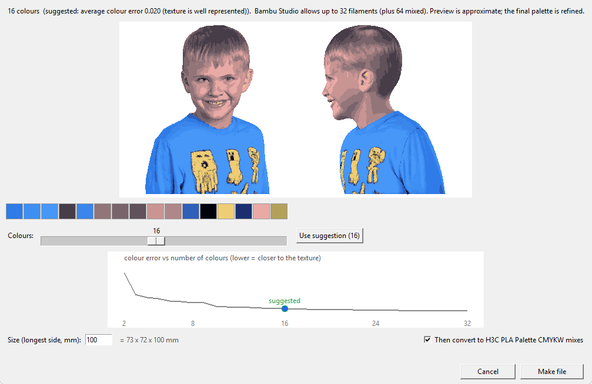
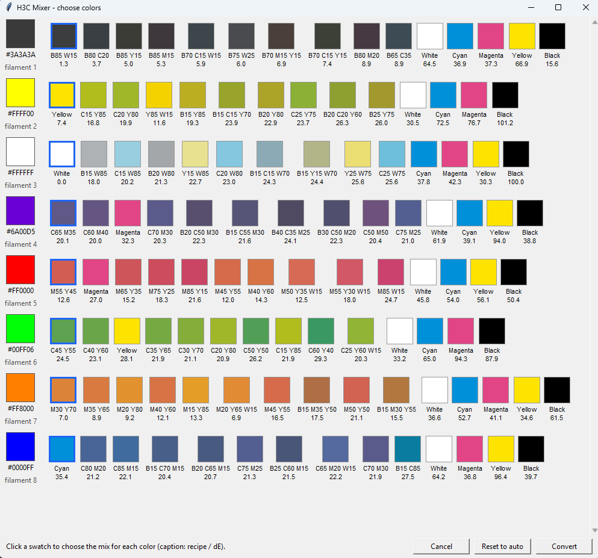

# H3C Mixer — PLA Palette CMYKW mixed-filament converter

Drag-and-drop converter that takes a color-painted Bambu Studio `.3mf` and
retargets it to a **Bambu Lab H3C** printing from five **PLA Palette CMYKW**
spools (Cyan, Magenta, Yellow, Black, White), turning every painted color into a
**mixed filament**.

Keywords: Bambu Lab H3C, PLA Palette CMYKW, mixed filament, color mixing,
multi-color 3MF, MakerLab Image to 3D, Bambu Studio.

Built for MakerLab "Image to 3D" exports, but it works on any painted 3MF, and
on textured **GLB** files too.

## Start from the GLB, not the 3MF

MakerLab offers the model as `.3mf` or `.glb`. **Use the GLB.** The 3MF has
already had its colors snapped to Bambu's filament catalog, so detail and true
hues are lost before this tool ever sees them. The GLB keeps the full texture.

Drop a `.glb` (or `.gltf`) on the same `.bat` and `glb2bambu.py` runs first:

* samples the texture for every triangle (inside each triangle, so the black
  gaps between texture islands never leak in)
* **measures how many colors the texture needs and suggests a count**, then opens
  a window where you slide from 2 to 32 colors and watch the model repaint live
  (front and side), with the palette and an error curve marking the suggestion
* evens out texture grain, then reduces to your count with area-weighted k-means
  in OKLab, merging look-alike shades so every slot is a visibly different color,
  then cleans up stray single-triangle specks
* welds the texture-seam vertices so the mesh is watertight for slicing
* scales it to the size you set in the window (default **100 mm** on the longest side) and
  stands it up Z-up on the bed
* writes `<name>_<N>colors.3mf` — a normal painted Bambu project with N filaments,
  usable on its own on any multi-color Bambu printer

…and then hands that file to the CMYKW converter (chooser window and all), so you
also get `<name>_<N>colors_H3C_mixed.3mf`. Run `python glb2bambu.py model.glb` if
you only want the N-color file.



**How the suggestion works.** The window plots how far the reduced colors are from
the real texture as you add colors. The suggestion is the first count where the
average error drops below a just-noticeable difference (about ΔE 2), or where two
more colors barely change anything. Simple, flat-colored models get a low number;
photo-real ones land around 14–20.

**Why 32 is the maximum.** Bambu Studio allows up to **32 physical filaments** per
project (plus up to 64 mixed filaments on top). Each color in the N-color file is
a physical filament, so 32 is the ceiling. For the H3C path every color then
becomes a mix of the 5 Palette spools, so more colors means more mixes and more
tool changes, not more spools.

Everything is set in that window — color count, size (it shows the resulting
W x D x H as you type), and a checkbox for whether to go on and make the H3C CMYKW
file. Just drop the file; nothing needs adding to the `.bat`.

**Works with any glTF**, not just MakerLab: `.glb` and `.gltf` (embedded,
data-URI or side-car `.bin`/image files), textures, vertex colors and plain
material colors (combined the way the glTF spec defines), multiple meshes,
materials and instanced/mirrored nodes, triangle strips and fans, sparse and
quantized data, texture wrap modes and `KHR_texture_transform`. Draco- or
meshopt-compressed files and KTX2 textures need a decoder this tool doesn't
include; it says so and suggests re-exporting uncompressed.

The GLB step needs **numpy** and **Pillow**: `pip install numpy pillow`.

## What it does

Writes `<name>_H3C_mixed.3mf` next to the original (the original is never touched):

| | |
|---|---|
| Printer | Bambu Lab H3C 0.4 nozzle |
| Process | `0.12mm High Quality @BBL H3C` (stock preset, not "modified") |
| Mixed-color sublayers | on |
| Spools | 1 White · 2 Cyan · 3 Magenta · 4 Yellow · 5 Black — `Bambu PLA Palette @BBL H3C` |
| Colors | each painted color → a mixed filament (or a solid spool if it's close enough) |
| Prime tower | enabled; position left as in the source file — place it yourself |
| Objects / supports / plates | untouched |

### How colors are matched

* Recipes come from Bambu Studio's own **measured** C+M+Y+K+W PLA Palette data
  (`resources/filament_mixing/standard_color_recipes.json`). The installed copy is
  used if Bambu Studio is present; a bundled copy is the fallback.
* In-between ratios (5 % steps, 15 % minimum per spool) are interpolated in Lab
  exactly the way Studio previews them, so the preview color Studio shows is the
  color the script scored.
* All colors are solved **together**: colors that differ in the model are kept
  apart in the print instead of collapsing into one mix.
* Matches are scored with **CIEDE2000** (set `USE_DE2000 = False` for Studio's CIE76).
* **Out-of-gamut colors keep their hue.** A pure `#0000FF` or `#00FF06` can't be
  mixed from C/M/Y/K/W; a plain color-difference metric would substitute a grey of
  the right darkness. For clearly saturated targets the matcher instead scores hue
  first, then vividness, then lightness, so blue stays blue (a violet-blue), green
  stays green, and nothing turns grey.
* Painted triangles are remapped at the bit level, including subdivided
  (split) triangles, so nothing is repainted or lost.

The report tells you how close each color got. Dark, saturated colors (navy,
wine red, deep purple) are outside what CMYKW can mix — those need a real spool.

## PrusaSlicer FullSpectrum files

Drop a **PrusaSlicer** 3MF (e.g. a FullSpectrum color-mix swatch from Printables)
on the same `.bat` and it is routed to `prusa2h3c.py`. PrusaSlicer stores mixes as
"virtual extruders" in `Prusa_Slicer_full_spectrum.json`, which Bambu Studio
ignores, so those files open with wrong colors. The converter keeps the design
**exactly** — no color matching:

* each used Prusa extruder → one H3C slot with the same color (override with
  `--colors "#0090DA,#E24585,..."` in slot order, e.g. to use PLA Palette C/M/Y)
* each virtual extruder → a Bambu mixed filament with the **same components and
  ratios** (Bambu allows up to 32 physical + 64 mixed slots)
* every part keeps its extruder; object positions are kept; unused extruders are dropped

## Use

Drop one or more `.3mf` files onto **`Drop 3MF here.bat`** (Windows), or:

```
python h3c_mix.py file.3mf|file.glb|file.gltf [more ...] [--auto] [--no-pause] [--colors N] [--size 100]
```

The flags are optional, for scripting only; dropping a file never needs them.
`--colors` and `--size` preset the GLB window; `--auto` skips both windows.

Before writing, a **chooser window** shows each source color next to its best
mix candidates (recipe and dE under each swatch). The automatic pick is
pre-selected; click another swatch to override it, then press **Convert**
(**Reset to auto** undoes your changes, **Cancel** writes nothing). Pass `--auto`
to skip the window and use the automatic picks (also used if no display is available).



Needs Python 3.8+ (plus numpy and Pillow for `.glb` input). `h3c_palette_base.json`
must stay next to the script.

## Install (no releases, just clone)

You need Python 3.8 or newer with tkinter (the standard python.org installer on
Windows includes it; tick **Add python.exe to PATH** when installing). For `.glb`
input also install two packages once:

```
pip install numpy pillow
```

```
git clone https://github.com/southsko/h3c-mixer.git
cd h3c-mixer
python h3c_mix.py "C:\path\to\your-model.3mf"
```

No git? Click the green **Code** button on GitHub, choose **Download ZIP**, and
unzip it anywhere. Keep `h3c_mix.py`, `glb2bambu.py`, `glb_selector.py`, `prusa2h3c.py`,
`h3c_palette_base.json` and `Drop 3MF here.bat` together in that folder.

Everyday use on Windows: drag a `.glb` or `.3mf` onto `Drop 3MF here.bat` (make a
desktop shortcut to it if you like). The converted `<name>_H3C_mixed.3mf` appears
next to the original; open it in Bambu Studio, place the prime tower, slice.

To update later, run `git pull` in the folder (or download the ZIP again). If
Bambu Studio is installed in the default location, the script automatically uses
its current color recipe table instead of the bundled copy.

## Credits

Color data and preview math follow [BambuStudio](https://github.com/bambulab/BambuStudio)
(`ColorDecomposeRecipe.cpp`, `FilamentMixer.cpp`, `TriangleSelector.cpp`).
`h3c_palette_base.json` contains H3C profile defaults and the CMYKW PLA Palette
recipe table from Bambu Studio 2.9.1. Not affiliated with Bambu Lab.
